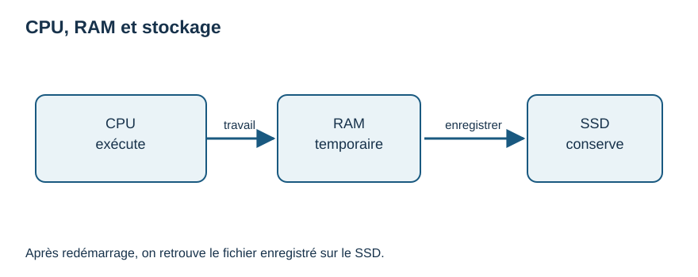
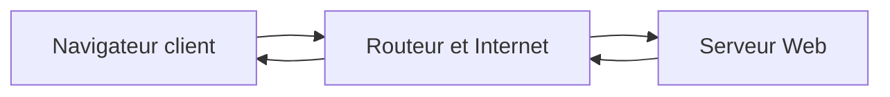
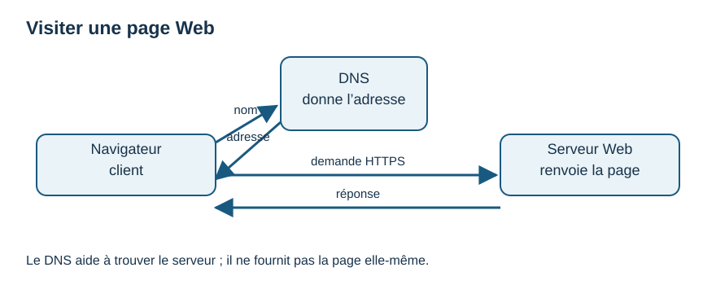

# M01 — Semaines 2–3 · Ordinateur, réseau et sécurité

Prérequis : M00. Temps : 3–5 h par semaine. À la fin, tu sais distinguer les principaux composants, expliquer le trajet d'une page Web et appliquer trois protections quotidiennes.

## Semaine 2 — Ce qui se passe dans l'ordinateur

### À quoi cela sert ?

Comprendre la différence entre mémoire et stockage aide à enregistrer ses fichiers, choisir un logiciel et résoudre un ralentissement. Une image utile : la **RAM** ressemble à une table de travail ; le **stockage** (SSD/disque) ressemble à une armoire. L'analogie a ses limites : ce sont des composants électroniques, pas de vrais meubles.

### Ce qu'il faut savoir

Le **processeur** (CPU) exécute les instructions. La RAM garde temporairement les données utiles aux logiciels ouverts ; son contenu courant se perd à l'arrêt. Le SSD conserve les fichiers enregistrés. Un **périphérique** permet une entrée (clavier), une sortie (écran) ou les deux. Le système d'exploitation gère ces ressources et les logiciels. Les données numériques sont représentées au niveau matériel par des **bits**, unités prenant deux états, souvent notés 0 et 1 ; huit bits forment un octet. Il n'est pas nécessaire de calculer en binaire pour utiliser Python.

**Lecture du schéma :** le CPU traite le travail en RAM ; l'enregistrement conserve une copie sur le stockage. Une phrase encore non enregistrée peut se perdre.

### Exemple expliqué pas à pas

Tu écris `Bonjour` dans l'éditeur : les touches envoient des entrées ; le CPU traite les instructions du logiciel ; le texte en cours est en RAM. Tu fais « Enregistrer » vers `bonjour.txt` : une version est écrite sur le stockage. Tu fermes puis redémarres : le texte enregistré revient depuis le stockage quand tu rouvres le fichier. Une modification **non enregistrée** pourrait être perdue.

| Élément | Question pratique | Exemple |
|---|---|---|
| CPU | Qui exécute ? | Le programme de l'éditeur. |
| RAM | Qu'est-ce qui sert maintenant ? | Le document ouvert. |
| Stockage | Que retrouve-t-on demain ? | Le fichier enregistré. |

### Essaye toi-même

Dessine un ordinateur avec clavier, écran, CPU, RAM et stockage. Écris où va une phrase pendant sa saisie puis après l'enregistrement. Option : trouve le nom de ton système dans ses paramètres, sans changer de réglage.

### 3 choses à retenir

1. CPU : exécution ; RAM : travail temporaire ; SSD : conservation des fichiers.
2. Le système d'exploitation organise l'utilisation du matériel et des logiciels.
3. Enregistrer et garder une seconde copie comptent plus que mémoriser des chiffres techniques.

### Comment vérifier si j'ai compris ?

Explique pourquoi un document non enregistré peut disparaître après une coupure. Distingue une mise à jour du système d'un fichier personnel. Si tu les confonds, refais le récit `bonjour.txt`.

## Semaine 3 — Une page Web et la sécurité quotidienne

### À quoi cela sert ?

Quand tu visites un site, plusieurs machines coopèrent. Comprendre leur rôle aide à reconnaître une adresse étrange, un problème de Wi-Fi ou un message de fraude.

### Ce qu'il faut savoir

Un **réseau local** relie des appareils proches. Le Wi-Fi est un moyen de liaison sans fil entre ton appareil et une borne/routeur ; il ne signifie pas que tout Internet fonctionne. Une **adresse IP** identifie une interface sur un réseau. Le **routeur** dirige des communications entre réseaux. **Internet** est un ensemble mondial de réseaux ; le **Web** est un service sur Internet qui fournit des pages. Ton navigateur est un **client** qui demande une ressource à un **serveur**. Le **DNS** associe un nom de domaine à une adresse utilisable pour joindre le service. **HTTP** décrit l'échange ; **HTTPS** ajoute un chiffrement de la connexion et une vérification du site, sans garantir que le vendeur ou le contenu est honnête.

Une **sauvegarde** est une autre copie que tu peux restaurer. Utilise un mot de passe différent pour chaque service, de préférence conservé dans un gestionnaire ; active la double authentification (**MFA**) si disponible. Le **phishing** ou hameçonnage est une tentative de te pousser à donner des informations en imitant une source fiable. Mets à jour ton appareil et vérifie l'adresse avant de te connecter.

### Exemple expliqué pas à pas

Tu saisis `https://exemple.org` dans le navigateur. L'appareil rejoint le réseau local ; le DNS aide à trouver l'adresse du serveur ; une demande HTTPS part vers ce serveur ; celui-ci renvoie la page ; le navigateur l'affiche. Si le Wi-Fi est connecté mais que la page échoue, le souci peut venir d'Internet, du DNS, du serveur ou de l'adresse : « Wi-Fi connecté » ne suffit pas comme diagnostic.

Un courriel fictif dit « Votre compte expire dans 5 minutes, cliquez et saisissez votre mot de passe ». Tu ne cliques pas. Tu ouvres toi-même l'application ou sa vraie adresse déjà connue, puis vérifies si une alerte existe. Tu n'envoies jamais ton mot de passe par message.

Le DNS aide à trouver la destination avant l'échange ; il n'est pas un moteur de recherche.

**Lecture du schéma :** le navigateur demande une adresse au DNS, contacte le serveur par HTTPS et reçoit la page. Le DNS ne contient pas la page.

### Essaye toi-même

Dessine le trajet d'une requête et écris sous chaque élément son rôle. Sur une **fausse** alerte que tu inventes, souligne trois signes qui te feraient vérifier par un autre moyen. Prévois où tu garderais une copie de `journal.txt`.

### 3 choses à retenir

1. Internet relie des réseaux ; le Web fournit notamment des pages dessus.
2. Le client demande, le serveur répond, le DNS aide à joindre le bon nom.
3. HTTPS, mots de passe uniques, MFA, mises à jour et sauvegardes réduisent les risques sans supprimer toute fraude.

### Comment vérifier si j'ai compris ?

Explique à une autre personne « Wi-Fi », « Internet » et « Web » sans les employer comme synonymes. Sur ton dessin, identifie le client et le serveur. Décris ce que tu ferais devant un lien de connexion pressant.
