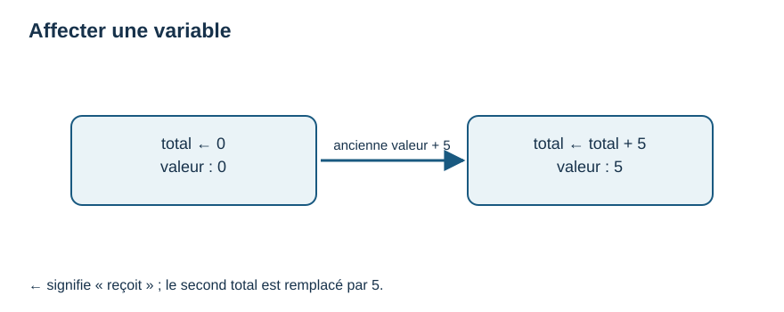
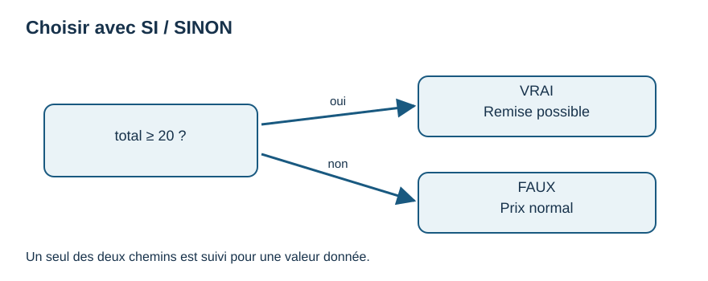
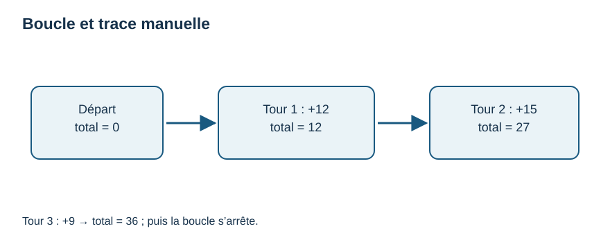

# M02 — Semaines 4–6 · Penser avant de programmer

Prérequis : M00–M01. Ici, aucune installation ni syntaxe Python. Le **pseudo-code** est une manière volontairement simple d'écrire les étapes d'une solution ; il n'est pas exécuté par l'ordinateur. Nous fixons une convention constante : `←` signifie « reçoit la valeur » ; `=` et `<` comparent des valeurs ; `AFFICHER` produit une sortie ; `LIRE` fournit une entrée. Un bloc se termine par `FIN SI`, `FIN POUR` ou `FIN TANT QUE`.

## Semaine 4 — Entrées, étapes et sorties

### À quoi cela sert ?

Décomposer une tâche évite de se perdre dans la syntaxe d'un langage. Un **algorithme** est une suite finie d'instructions précises qui résout un problème. Une recette est une analogie utile si les ingrédients et les quantités sont connus ; en informatique, les étapes doivent être assez précises pour être suivies sans deviner.

### Ce qu'il faut savoir

Une **entrée** est une donnée reçue, un **traitement** transforme les données, une **sortie** est le résultat communiqué. Pour un achat, l'entrée est le prix et l'argent donné ; le traitement calcule la monnaie ; la sortie est le montant à rendre. On écrit d'abord trois exemples à la main pour préciser les règles : 8 € payés avec 10 € → 2 € ; 10 € avec 10 € → 0 € ; 12 € avec 10 € → paiement insuffisant. Ici, on travaille en euros entiers pour éviter les arrondis ; les centimes viendront avec une représentation adaptée.

### Exemple expliqué pas à pas

```text
LIRE prix
LIRE paiement
SI paiement < prix ALORS
    AFFICHER "Paiement insuffisant"
SINON
    monnaie ← paiement - prix
    AFFICHER monnaie
FIN SI
```

Avec `prix=8` et `paiement=10`, la condition `10 < 8` est fausse ; on calcule `10 - 8`, puis on affiche `2`. Avec `prix=12`, on suit l'autre branche ; on ne calcule pas une monnaie négative.

### Essaye toi-même

Écris les entrées, étapes et sorties d'une recette de deux portions, puis du calcul d'un prix pour trois articles identiques. Donne trois cas concrets pour chaque tâche.

### 3 choses à retenir

1. Le problème et les cas exemples précèdent le pseudo-code.
2. Chaque instruction doit être claire et dans le bon ordre.
3. Une condition permet de choisir un chemin.

### Comment vérifier si j'ai compris ?

Sans ordinateur, suis le pseudo-code avec `prix=4`, `paiement=4`, puis `paiement=2`. Annonce exactement ce qui s'affiche.

## Semaine 5 — Variables, types, conditions et trace

### À quoi cela sert ?

Une **variable** porte un nom et une valeur qui peut changer. Elle permet de retenir un prix, un compteur ou une réponse. Le **type** décrit la sorte de valeur : nombre entier, texte ou booléen (`VRAI`/`FAUX`). Un texte `"5"` n'est pas automatiquement le nombre `5`.

### Ce qu'il faut savoir

`total ← 0` affecte zéro à `total`. `total ← total + prix` lit l'ancienne valeur, additionne le prix, puis remplace la valeur. Ce n'est pas une égalité mathématique. Les opérateurs `+`, `-`, `*` calculent ; `>`, `<`, `=` comparent ; `ET`, `OU`, `NON` combinent des conditions. Une condition composée doit être vérifiée avec des cas limites : « âge entre 18 et 25 inclus » s'écrit `age >= 18 ET age <= 25`. Un **organigramme** représente le flux avec un début, des actions et une question à deux branches.



**Lecture :** avec `total ← total + 5`, la nouvelle valeur remplace l'ancienne ; `←` n'est pas un test d'égalité.

### Exemple expliqué pas à pas

```text
total ← 0
LIRE prix
total ← total + prix
SI total >= 20 ALORS
    AFFICHER "Remise possible"
SINON
    AFFICHER "Prix normal"
FIN SI
```

Trace manuelle pour `prix=22` :

| Étape | `prix` | `total` | Sortie |
|---|---:|---:|---|
| Après `total ← 0` | non lu | 0 | — |
| Après `LIRE prix` | 22 | 0 | — |
| Après addition | 22 | 22 | — |
| Condition vraie | 22 | 22 | Remise possible |

Changer `prix` en 19 change la branche. On teste aussi 20, la frontière.



**Lecture :** pour `total=20`, on suit « oui » ; pour `total=19`, « non ». Une seule phrase est affichée.

### Essaye toi-même

Trace le même programme avec 19 et 20. Dessine un losange « total >= 20 ? » avec les deux issues et la phrase affichée au bout de chacune. Essaie une condition pour un horaire de 9 à 18 heures inclus.

### 3 choses à retenir

1. `←` modifie une variable ; `=` dans une condition compare selon notre convention.
2. Le type et la valeur sont distincts ; `"5"` est du texte.
3. Une trace suit les valeurs ligne par ligne et teste les frontières.

### Comment vérifier si j'ai compris ?

Pour `compteur ← 2` puis `compteur ← compteur + 3`, dis la valeur finale et explique pourquoi elle vaut 5. Prévois la sortie du programme pour 19, 20 et 22.

## Semaine 6 — Répéter, ranger et arrêter

### À quoi cela sert ?

Une **boucle** répète des étapes. `POUR` convient quand on connaît les positions à parcourir ; `TANT QUE` quand on attend qu'une condition change. Une **liste** ou tableau simple range plusieurs valeurs sous un même nom. Nous numérotons les positions de 0 à `longueur - 1`, comme Python plus tard.

### Ce qu'il faut savoir

Une boucle doit atteindre sa fin. Dans `TANT QUE`, demande toujours : « Qu'est-ce qui change pour rendre la condition fausse ? » Pour une liste `notes ← [12, 15, 9]`, `notes[0]` vaut 12 et sa longueur vaut 3. Éviter `notes[3]`, qui n'existe pas. `POUR i DE 0 À 2` parcourt exactement trois indices dans notre convention **borne supérieure incluse** ; plus tard Python `range(0, 3)` a une borne supérieure exclue.

### Exemple expliqué pas à pas

```text
notes ← [12, 15, 9]
total ← 0
POUR i DE 0 À 2 FAIRE
    total ← total + notes[i]
FIN POUR
AFFICHER total
```

| Passage | `i` | `notes[i]` | `total` après addition |
|---:|---:|---:|---:|
| 1 | 0 | 12 | 12 |
| 2 | 1 | 15 | 27 |
| 3 | 2 | 9 | 36 |



**Lecture :** chaque tour ajoute une valeur au total. Après le troisième tour, `total=36` et la boucle se termine.

Pour contrôler une saisie : `LIRE age` puis `TANT QUE age < 0 FAIRE LIRE age FIN TANT QUE`. Si la nouvelle saisie n'est jamais lue, la boucle peut ne jamais finir. Un test simple consiste à prévoir les sorties avec liste vide, un élément et trois éléments ; une liste vide exige un parcours qui ne commence pas.

### Essaye toi-même

Trace une liste `[4, 7]` et calcule sa somme. Écris une boucle qui redemande un nombre tant qu'il est inférieur à 1. Option courte : explore Scratch pendant 45 minutes pour représenter une condition, puis reviens au pseudo-code ; Scratch n'est pas requis.

### 3 choses à retenir

1. Une liste stocke des valeurs et commence à l'indice 0 dans ce parcours.
2. `POUR` parcourt une quantité connue ; `TANT QUE` attend une condition d'arrêt.
3. Une trace permet de vérifier chaque passage et d'éviter les boucles infinies.

### Comment vérifier si j'ai compris ?

Explique le résultat 36 sans exécuter le programme. Quel est le dernier indice de cinq éléments ? Pourquoi la saisie doit-elle être relue dans `TANT QUE` ?
