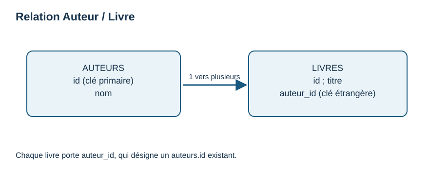

# Option après S11 — relier un auteur et des livres

Une **entité** est une chose dont on garde des informations : ici `auteur` et `livre`. Un **attribut** est une propriété : le nom de l'auteur, le titre du livre. On les range dans deux tables.

| Table | Colonnes utiles | Rôle |
|---|---|---|
| `auteurs` | `id` (clé primaire), `nom` | Chaque auteur a un identifiant unique. |
| `livres` | `id` (clé primaire), `titre`, `auteur_id` (clé étrangère) | `auteur_id` désigne `auteurs.id`. |

Si Awa a `id=1`, deux livres peuvent avoir `auteur_id=1` : la relation est **1 vers N** (« un vers plusieurs »). Chaque ligne de `livres` renvoie ici à un auteur ; la même personne peut écrire plusieurs livres. Une clé étrangère fait le lien ; elle ne recopie pas le nom à chaque ligne. En SQLite, `PRAGMA foreign_keys = ON;` active la vérification des clés étrangères pour la connexion courante.

Dans [Q05](../03_EXERCICES/ENONCES_SQL.md), dessine d'abord les deux tableaux sur papier et trace une flèche de `livres.auteur_id` vers `auteurs.id`. La [fiche SQL pas à pas](PRATIQUER_SQL_PAS_A_PAS.md) explique comment essayer la jointure localement. Cette extension est facultative ; il n'est pas nécessaire d'apprendre UML.
