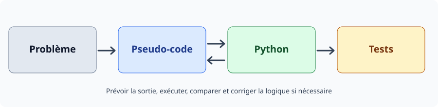

# Sept ateliers guidés : je comprends → je remplis → je teste → je corrige

Les **58 exercices du parcours principal restent inchangés**. Ces sept ateliers sont un complément conseillé pour travailler sur des fichiers de départ concrets.

**Comment procéder :** ouvre CONSIGNE.md → copie A_COMPLETER.txt / .py (ou CODE_A_CORRIGER.py) dans **mes_exercices/Sxx** → remplis sans aide → prédis deux résultats → exécute s'il s'agit de Python → consulte CORRIGES/ATxx.md **seulement après** → recommence une variante.

- Un **.txt** est le meilleur format simple ici pour le pseudo-code : tu peux l'écrire sur tout ordinateur, sans installer de langage.
- Un **.py** est exécutable dans Thonny dès S7 ; les TODO indiquent ce que tu dois écrire.
- Une solution peut différer du modèle tout en étant juste : compare le raisonnement, les sorties et les cas limites.

| Atelier | Semaine | Ce que tu apprends | Démarrer | Corrigé |
|---|---|---|---|---|
| AT01 — séquence | S4 | Entrée → traitement → sortie | [Consigne](AT01/CONSIGNE.md) | [Correction](CORRIGES/AT01.md) |
| AT02 — conditions | S5 | SI/SINON et seuils | [Consigne](AT02/CONSIGNE.md) | [Correction](CORRIGES/AT02.md) |
| AT03 — boucles | S6 | Compteur, accumulateur, trace | [Consigne](AT03/CONSIGNE.md) | [Correction](CORRIGES/AT03.md) |
| AT04 — pseudo → Python | S8 | Traduire LIRE/SI/AFFICHER | [Consigne](AT04/CONSIGNE.md) | [Correction](CORRIGES/AT04.md) |
| AT05 — Python → pseudo | S9 | Comprendre for/range | [Consigne](AT05/CONSIGNE.md) | [Correction](CORRIGES/AT05.md) |
| AT06 — aller-retour | S11 | Fonctions et return | [Consigne](AT06/CONSIGNE.md) | [Correction](CORRIGES/AT06.md) |
| AT07 — débogage | S12 | Erreur de logique et test limite | [Consigne](AT07/CONSIGNE.md) | [Correction](CORRIGES/AT07.md) |

