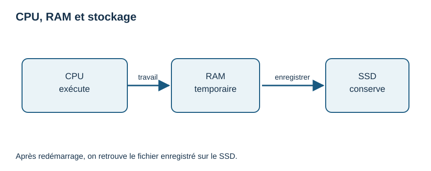
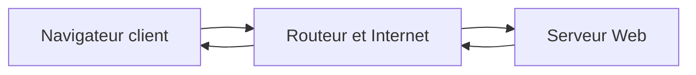
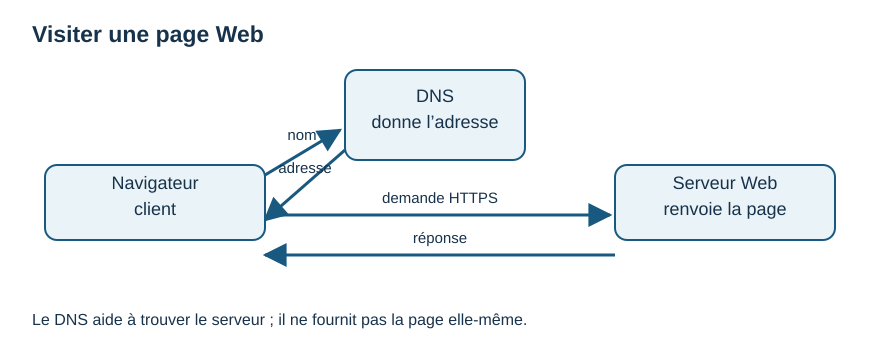
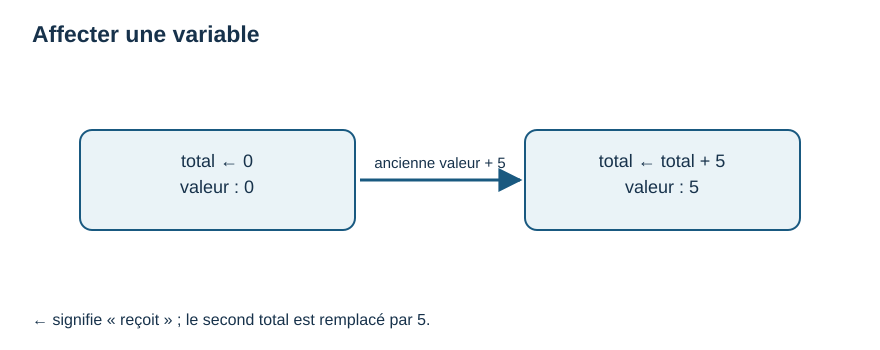
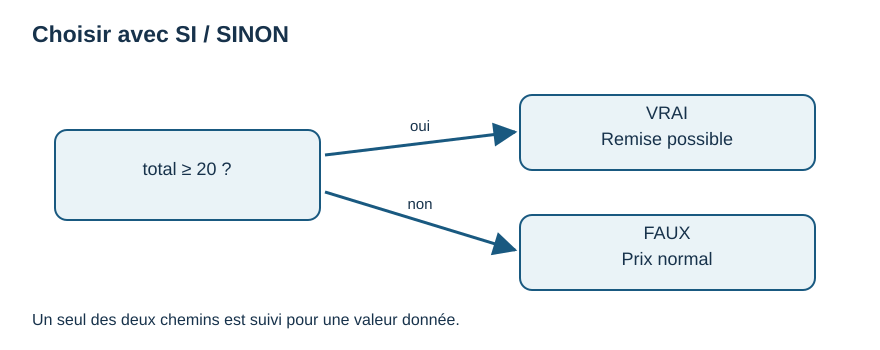
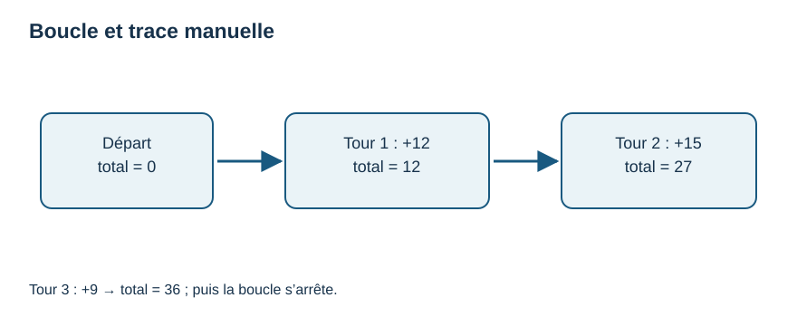
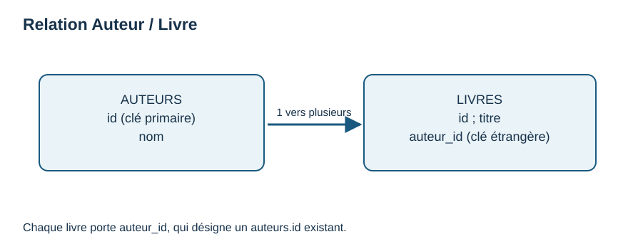

# Guide complet — informatique débutante, 18 semaines

Ce document réunit les **neuf cours originaux** du parcours dans l'ordre. Pour suivre les exercices et les projets, commence par [l'index](INDEX.md) et le [mode d'emploi](README_COMMENCER_ICI.md). Les fichiers autonomes sont dans `01_COURS/` ; ce guide est reconstruit depuis ces modules avec `python tools/construire_guide.py`.

**Repères :** M00 = semaine 1 ; M01 = 2–3 ; M02 = 4–6 ; M03 = 7–11 ; M04 = 12 ; M05 = 13–14 ; M06 = 15 ; M07 = 16 ; M08 = 17–18. Prévoir 3–5 heures par semaine.

---

# M00 — Semaine 1 · Prendre ses repères

**Objectif :** ouvrir un logiciel, créer un dossier, enregistrer et retrouver un fichier, comprendre ce qu'est une extension. Aucun prérequis. Temps : 3–5 h.

## À quoi cela sert ?

Un programme qu'on ne retrouve pas est difficile à améliorer. Avant de coder, on apprend à ranger et retrouver son travail, comme on classe des feuilles dans des chemises. L'ordinateur exécute des **logiciels** ; leurs documents sont des **fichiers**. Le logiciel et le fichier sont deux choses différentes.

## Ce qu'il faut savoir

Un **dossier** contient des fichiers ou d'autres dossiers. Un **nom de fichier** peut se terminer par une **extension**, par exemple `notes.txt` (texte), `page.html` (page Web) ou `bonjour.py` (programme Python). L'extension aide le système à choisir un logiciel, mais elle ne rend pas un contenu valide à elle seule. Le **navigateur** (browser) affiche des pages Web ; une adresse URL se saisit dans sa barre d'adresse. Un onglet n'est pas un fichier enregistré.

Un **système d'exploitation** (OS), comme Windows, macOS ou Linux, permet d'ouvrir des logiciels et de gérer les fichiers. Le pointeur suit la souris ; un clic sélectionne, un double-clic ouvre souvent, et `Ctrl+S` (Windows/Linux) ou `⌘+S` (macOS) enregistre dans beaucoup de logiciels. Vérifie le nom et le dossier dans la fenêtre d'enregistrement. Fermer une fenêtre ne supprime pas le fichier enregistré.

> **Attention :** ne télécharge un logiciel que depuis sa page officielle ou la boutique officielle de ton système. Les publicités « Télécharger » peuvent mener ailleurs. N'exécute pas une pièce jointe inconnue.

## Exemple expliqué pas à pas

1. Ouvre ton gestionnaire de fichiers et repère le dossier **Documents**. Crée `mes_exercices`, puis `S01` dedans. Si les menus varient, utilise « Nouveau dossier ».
2. Ouvre un éditeur de texte simple. Écris : `Aujourd'hui, j'ai créé mon premier fichier.` Choisis **Enregistrer sous**, va dans `mes_exercices/S01`, nomme le fichier `journal.txt`, puis enregistre.
3. Ferme l'éditeur. Dans le gestionnaire, retrouve `journal.txt` et ouvre-le. La phrase est encore là : elle a été enregistrée sur le stockage. Fais une copie nommée `journal_copie.txt`.
4. Ouvre ton navigateur et tape l'adresse d'un site connu. Reconnais l'adresse et les onglets. Ferme un onglet : les deux fichiers dans `S01` existent toujours.

| Objet | Exemple | À quoi il sert |
|---|---|---|
| Logiciel | Éditeur de texte | Permet de créer ou lire. |
| Fichier | `journal.txt` | Conserve un contenu. |
| Dossier | `S01` | Range plusieurs fichiers. |

## Essaye toi-même

Dans `S01`, crée `questions.txt` avec trois questions que tu te poses sur l'informatique. Ferme puis rouvre le fichier ; crée une copie. Trouve l'extension de chaque fichier. **Ne lis pas une solution avant d'avoir essayé.** Option 5 h : déplace la copie dans un sous-dossier `copies` et vérifie où elle se trouve.

## 3 choses à retenir

1. Un logiciel ouvre ou crée des fichiers ; un dossier les range.
2. Enregistrer signifie choisir un nom et un emplacement puis vérifier que le fichier existe.
3. Une page dans le navigateur ne se confond pas avec un fichier local.

## Comment vérifier si j'ai compris ?

Sans rouvrir les consignes, retrouve `questions.txt` après fermeture de l'éditeur. Explique à voix haute « logiciel », « fichier », « dossier » et « extension ». Si tu hésites, refais les quatre manipulations une fois. Inscris ton résultat dans le suivi.

**Méthode de travail et IA :** note tes questions et ce que tu as essayé. Une IA peut donner un indice ou expliquer un message d'erreur, mais elle peut inventer : vérifie par une manipulation. Ne lui donne aucune donnée privée. Fiche dédiée : `02_FICHES/UTILISER_IA_POUR_APPRENDRE.md`.

---

# M01 — Semaines 2–3 · Ordinateur, réseau et sécurité

Prérequis : M00. Temps : 3–5 h par semaine. À la fin, tu sais distinguer les principaux composants, expliquer le trajet d'une page Web et appliquer trois protections quotidiennes.

## Semaine 2 — Ce qui se passe dans l'ordinateur

### À quoi cela sert ?

Comprendre la différence entre mémoire et stockage aide à enregistrer ses fichiers, choisir un logiciel et résoudre un ralentissement. Une image utile : la **RAM** ressemble à une table de travail ; le **stockage** (SSD/disque) ressemble à une armoire. L'analogie a ses limites : ce sont des composants électroniques, pas de vrais meubles.

### Ce qu'il faut savoir

Le **processeur** (CPU) exécute les instructions. La RAM garde temporairement les données utiles aux logiciels ouverts ; son contenu courant se perd à l'arrêt. Le SSD conserve les fichiers enregistrés. Un **périphérique** permet une entrée (clavier), une sortie (écran) ou les deux. Le système d'exploitation gère ces ressources et les logiciels. Les données numériques sont représentées au niveau matériel par des **bits**, unités prenant deux états, souvent notés 0 et 1 ; huit bits forment un octet. Il n'est pas nécessaire de calculer en binaire pour utiliser Python.



**Lecture du schéma :** le CPU traite le travail en RAM ; l'enregistrement conserve une copie sur le stockage. Une phrase encore non enregistrée peut se perdre.

### Exemple expliqué pas à pas

Tu écris `Bonjour` dans l'éditeur : les touches envoient des entrées ; le CPU traite les instructions du logiciel ; le texte en cours est en RAM. Tu fais « Enregistrer » vers `bonjour.txt` : une version est écrite sur le stockage. Tu fermes puis redémarres : le texte enregistré revient depuis le stockage quand tu rouvres le fichier. Une modification **non enregistrée** pourrait être perdue.

| Élément | Question pratique | Exemple |
|---|---|---|
| CPU | Qui exécute ? | Le programme de l'éditeur. |
| RAM | Qu'est-ce qui sert maintenant ? | Le document ouvert. |
| Stockage | Que retrouve-t-on demain ? | Le fichier enregistré. |

### Essaye toi-même

Dessine un ordinateur avec clavier, écran, CPU, RAM et stockage. Écris où va une phrase pendant sa saisie puis après l'enregistrement. Option : trouve le nom de ton système dans ses paramètres, sans changer de réglage.

### 3 choses à retenir

1. CPU : exécution ; RAM : travail temporaire ; SSD : conservation des fichiers.
2. Le système d'exploitation organise l'utilisation du matériel et des logiciels.
3. Enregistrer et garder une seconde copie comptent plus que mémoriser des chiffres techniques.

### Comment vérifier si j'ai compris ?

Explique pourquoi un document non enregistré peut disparaître après une coupure. Distingue une mise à jour du système d'un fichier personnel. Si tu les confonds, refais le récit `bonjour.txt`.

## Semaine 3 — Une page Web et la sécurité quotidienne

### À quoi cela sert ?

Quand tu visites un site, plusieurs machines coopèrent. Comprendre leur rôle aide à reconnaître une adresse étrange, un problème de Wi-Fi ou un message de fraude.

### Ce qu'il faut savoir

Un **réseau local** relie des appareils proches. Le Wi-Fi est un moyen de liaison sans fil entre ton appareil et une borne/routeur ; il ne signifie pas que tout Internet fonctionne. Une **adresse IP** identifie une interface sur un réseau. Le **routeur** dirige des communications entre réseaux. **Internet** est un ensemble mondial de réseaux ; le **Web** est un service sur Internet qui fournit des pages. Ton navigateur est un **client** qui demande une ressource à un **serveur**. Le **DNS** associe un nom de domaine à une adresse utilisable pour joindre le service. **HTTP** décrit l'échange ; **HTTPS** ajoute un chiffrement de la connexion et une vérification du site, sans garantir que le vendeur ou le contenu est honnête.

Une **sauvegarde** est une autre copie que tu peux restaurer. Utilise un mot de passe différent pour chaque service, de préférence conservé dans un gestionnaire ; active la double authentification (**MFA**) si disponible. Le **phishing** ou hameçonnage est une tentative de te pousser à donner des informations en imitant une source fiable. Mets à jour ton appareil et vérifie l'adresse avant de te connecter.

### Exemple expliqué pas à pas

Tu saisis `https://exemple.org` dans le navigateur. L'appareil rejoint le réseau local ; le DNS aide à trouver l'adresse du serveur ; une demande HTTPS part vers ce serveur ; celui-ci renvoie la page ; le navigateur l'affiche. Si le Wi-Fi est connecté mais que la page échoue, le souci peut venir d'Internet, du DNS, du serveur ou de l'adresse : « Wi-Fi connecté » ne suffit pas comme diagnostic.

Un courriel fictif dit « Votre compte expire dans 5 minutes, cliquez et saisissez votre mot de passe ». Tu ne cliques pas. Tu ouvres toi-même l'application ou sa vraie adresse déjà connue, puis vérifies si une alerte existe. Tu n'envoies jamais ton mot de passe par message.



Le DNS aide à trouver la destination avant l'échange ; il n'est pas un moteur de recherche.



**Lecture du schéma :** le navigateur demande une adresse au DNS, contacte le serveur par HTTPS et reçoit la page. Le DNS ne contient pas la page.

### Essaye toi-même

Dessine le trajet d'une requête et écris sous chaque élément son rôle. Sur une **fausse** alerte que tu inventes, souligne trois signes qui te feraient vérifier par un autre moyen. Prévois où tu garderais une copie de `journal.txt`.

### 3 choses à retenir

1. Internet relie des réseaux ; le Web fournit notamment des pages dessus.
2. Le client demande, le serveur répond, le DNS aide à joindre le bon nom.
3. HTTPS, mots de passe uniques, MFA, mises à jour et sauvegardes réduisent les risques sans supprimer toute fraude.

### Comment vérifier si j'ai compris ?

Explique à une autre personne « Wi-Fi », « Internet » et « Web » sans les employer comme synonymes. Sur ton dessin, identifie le client et le serveur. Décris ce que tu ferais devant un lien de connexion pressant.

---

# M02 — Semaines 4–6 · Penser avant de programmer

Prérequis : M00–M01. Ici, aucune installation ni syntaxe Python. Le **pseudo-code** est une manière volontairement simple d'écrire les étapes d'une solution ; il n'est pas exécuté par l'ordinateur. Nous fixons une convention constante : `←` signifie « reçoit la valeur » ; `=` et `<` comparent des valeurs ; `AFFICHER` produit une sortie ; `LIRE` fournit une entrée. Un bloc se termine par `FIN SI`, `FIN POUR` ou `FIN TANT QUE`.

## Semaine 4 — Entrées, étapes et sorties

### À quoi cela sert ?

Décomposer une tâche évite de se perdre dans la syntaxe d'un langage. Un **algorithme** est une suite finie d'instructions précises qui résout un problème. Une recette est une analogie utile si les ingrédients et les quantités sont connus ; en informatique, les étapes doivent être assez précises pour être suivies sans deviner.

### Ce qu'il faut savoir

Une **entrée** est une donnée reçue, un **traitement** transforme les données, une **sortie** est le résultat communiqué. Pour un achat, l'entrée est le prix et l'argent donné ; le traitement calcule la monnaie ; la sortie est le montant à rendre. On écrit d'abord trois exemples à la main pour préciser les règles : 8 € payés avec 10 € → 2 € ; 10 € avec 10 € → 0 € ; 12 € avec 10 € → paiement insuffisant. Ici, on travaille en euros entiers pour éviter les arrondis ; les centimes viendront avec une représentation adaptée.

### Exemple expliqué pas à pas

```text
LIRE prix
LIRE paiement
SI paiement < prix ALORS
    AFFICHER "Paiement insuffisant"
SINON
    monnaie ← paiement - prix
    AFFICHER monnaie
FIN SI
```

Avec `prix=8` et `paiement=10`, la condition `10 < 8` est fausse ; on calcule `10 - 8`, puis on affiche `2`. Avec `prix=12`, on suit l'autre branche ; on ne calcule pas une monnaie négative.

### Essaye toi-même

Écris les entrées, étapes et sorties d'une recette de deux portions, puis du calcul d'un prix pour trois articles identiques. Donne trois cas concrets pour chaque tâche.

### 3 choses à retenir

1. Le problème et les cas exemples précèdent le pseudo-code.
2. Chaque instruction doit être claire et dans le bon ordre.
3. Une condition permet de choisir un chemin.

### Comment vérifier si j'ai compris ?

Sans ordinateur, suis le pseudo-code avec `prix=4`, `paiement=4`, puis `paiement=2`. Annonce exactement ce qui s'affiche.

## Semaine 5 — Variables, types, conditions et trace

### À quoi cela sert ?

Une **variable** porte un nom et une valeur qui peut changer. Elle permet de retenir un prix, un compteur ou une réponse. Le **type** décrit la sorte de valeur : nombre entier, texte ou booléen (`VRAI`/`FAUX`). Un texte `"5"` n'est pas automatiquement le nombre `5`.

### Ce qu'il faut savoir

`total ← 0` affecte zéro à `total`. `total ← total + prix` lit l'ancienne valeur, additionne le prix, puis remplace la valeur. Ce n'est pas une égalité mathématique. Les opérateurs `+`, `-`, `*` calculent ; `>`, `<`, `=` comparent ; `ET`, `OU`, `NON` combinent des conditions. Une condition composée doit être vérifiée avec des cas limites : « âge entre 18 et 25 inclus » s'écrit `age >= 18 ET age <= 25`. Un **organigramme** représente le flux avec un début, des actions et une question à deux branches.



**Lecture :** avec `total ← total + 5`, la nouvelle valeur remplace l'ancienne ; `←` n'est pas un test d'égalité.

### Exemple expliqué pas à pas

```text
total ← 0
LIRE prix
total ← total + prix
SI total >= 20 ALORS
    AFFICHER "Remise possible"
SINON
    AFFICHER "Prix normal"
FIN SI
```

Trace manuelle pour `prix=22` :

| Étape | `prix` | `total` | Sortie |
|---|---:|---:|---|
| Après `total ← 0` | non lu | 0 | — |
| Après `LIRE prix` | 22 | 0 | — |
| Après addition | 22 | 22 | — |
| Condition vraie | 22 | 22 | Remise possible |

Changer `prix` en 19 change la branche. On teste aussi 20, la frontière.



**Lecture :** pour `total=20`, on suit « oui » ; pour `total=19`, « non ». Une seule phrase est affichée.

### Essaye toi-même

Trace le même programme avec 19 et 20. Dessine un losange « total >= 20 ? » avec les deux issues et la phrase affichée au bout de chacune. Essaie une condition pour un horaire de 9 à 18 heures inclus.

### 3 choses à retenir

1. `←` modifie une variable ; `=` dans une condition compare selon notre convention.
2. Le type et la valeur sont distincts ; `"5"` est du texte.
3. Une trace suit les valeurs ligne par ligne et teste les frontières.

### Comment vérifier si j'ai compris ?

Pour `compteur ← 2` puis `compteur ← compteur + 3`, dis la valeur finale et explique pourquoi elle vaut 5. Prévois la sortie du programme pour 19, 20 et 22.

## Semaine 6 — Répéter, ranger et arrêter

### À quoi cela sert ?

Une **boucle** répète des étapes. `POUR` convient quand on connaît les positions à parcourir ; `TANT QUE` quand on attend qu'une condition change. Une **liste** ou tableau simple range plusieurs valeurs sous un même nom. Nous numérotons les positions de 0 à `longueur - 1`, comme Python plus tard.

### Ce qu'il faut savoir

Une boucle doit atteindre sa fin. Dans `TANT QUE`, demande toujours : « Qu'est-ce qui change pour rendre la condition fausse ? » Pour une liste `notes ← [12, 15, 9]`, `notes[0]` vaut 12 et sa longueur vaut 3. Éviter `notes[3]`, qui n'existe pas. `POUR i DE 0 À 2` parcourt exactement trois indices dans notre convention **borne supérieure incluse** ; plus tard Python `range(0, 3)` a une borne supérieure exclue.

### Exemple expliqué pas à pas

```text
notes ← [12, 15, 9]
total ← 0
POUR i DE 0 À 2 FAIRE
    total ← total + notes[i]
FIN POUR
AFFICHER total
```

| Passage | `i` | `notes[i]` | `total` après addition |
|---:|---:|---:|---:|
| 1 | 0 | 12 | 12 |
| 2 | 1 | 15 | 27 |
| 3 | 2 | 9 | 36 |



**Lecture :** chaque tour ajoute une valeur au total. Après le troisième tour, `total=36` et la boucle se termine.

Pour contrôler une saisie : `LIRE age` puis `TANT QUE age < 0 FAIRE LIRE age FIN TANT QUE`. Si la nouvelle saisie n'est jamais lue, la boucle peut ne jamais finir. Un test simple consiste à prévoir les sorties avec liste vide, un élément et trois éléments ; une liste vide exige un parcours qui ne commence pas.

### Essaye toi-même

Trace une liste `[4, 7]` et calcule sa somme. Écris une boucle qui redemande un nombre tant qu'il est inférieur à 1. Option courte : explore Scratch pendant 45 minutes pour représenter une condition, puis reviens au pseudo-code ; Scratch n'est pas requis.

### 3 choses à retenir

1. Une liste stocke des valeurs et commence à l'indice 0 dans ce parcours.
2. `POUR` parcourt une quantité connue ; `TANT QUE` attend une condition d'arrêt.
3. Une trace permet de vérifier chaque passage et d'éviter les boucles infinies.

### Comment vérifier si j'ai compris ?

Explique le résultat 36 sans exécuter le programme. Quel est le dernier indice de cinq éléments ? Pourquoi la saisie doit-elle être relue dans `TANT QUE` ?

---

# M03 — Semaines 7–11 · Programmer en Python 3

Prérequis : M02. Python 3 est le **seul langage de programmation principal** du parcours. Nous utilisons Thonny, un éditeur gratuit pour débuter ; son interpréteur Python peut être inclus selon la plateforme. Le code des exemples est complet : copie chaque bloc dans un **nouveau** fichier `.py`, enregistre, puis exécute. Rien ici ne demande Internet après installation. La fiche d'installation donne la marche à suivre.

## Semaine 7 — Premières instructions et saisie

### À quoi cela sert ?

Tu as déjà écrit les étapes d'un calcul ; Python permet à l'ordinateur de les suivre. Le pseudo-code `AFFICHER` devient `print(...)` ; `LIRE` devient `input(...)`. Le programme est un fichier texte que l'interpréteur Python lit et exécute.

### Ce qu'il faut savoir

Dans Thonny, écris le programme dans l'éditeur (partie supérieure), enregistre `bonjour.py` dans `mes_exercices/S07`, puis utilise **Run / Exécuter** (souvent F5). Le résultat et les questions apparaissent dans la **console**. `input` renvoie du texte même si l'on tape des chiffres. Une chaîne de caractères est du texte entre guillemets. Le signe Python `=` **affecte**, il correspond à `←` en pseudo-code ; le test d'égalité en Python est `==`.

### Exemple expliqué pas à pas

```python
prenom = input("Quel prénom fictif utiliser ? ")
print("Bonjour", prenom)
```

L'interpréteur pose la question, attend la saisie, place la réponse dans `prenom`, puis affiche deux éléments séparés par un espace. Si tu tapes `Ari`, la sortie est `Bonjour Ari`. La variable ne contient pas les guillemets. Pour utiliser un nombre :

```python
prix = int(input("Prix entier en euros ? "))
paiement = int(input("Montant payé ? "))
print("Différence :", paiement - prix)
```

`int(...)` convertit le texte saisi en entier. Si tu tapes `abc`, Python signale `ValueError` ; à ce stade, relance et saisis un entier valide. La gestion d'erreur arrive en S12.

| Pseudo-code | Python 3 | Sens |
|---|---|---|
| `LIRE prenom` | `prenom = input("Prénom ? ")` | Attendre du texte. |
| `AFFICHER prenom` | `print(prenom)` | Afficher. |
| `total ← 0` | `total = 0` | Affecter une valeur. |

### Essaye toi-même

Crée `salutation.py` qui demande un nom fictif et une ville fictive, puis les affiche dans une phrase. Reprends le calcul de monnaie de S4 avec des montants entiers positifs et, pour le moment, teste seulement des paiements suffisants.

### 3 choses à retenir

1. Un fichier `.py` contient du texte que Python peut exécuter.
2. `input` fournit une chaîne ; `int` convertit en entier si possible.
3. `=` affecte en Python ; une comparaison d'égalité utilisera `==`.

### Comment vérifier si j'ai compris ?

Ferme et rouvre Thonny, retrouve `bonjour.py`, exécute-le. Prévois ce qui s'affiche si tu tapes `Sam` avant de lancer le programme.

## Semaine 8 — Types, calculs et choix

### À quoi cela sert ?

Une condition permet de répondre différemment à une entrée. Des **types** différents demandent des traitements différents : `"12" + "3"` assemble des textes ; `12 + 3` additionne des nombres. `float` représente un nombre décimal mais peut introduire de petites imprécisions ; nos exemples de prix restent en euros entiers.

### Ce qu'il faut savoir

`int`, `float`, `str` et `bool` désignent respectivement entier, nombre décimal, texte et booléen. Une comparaison (`<`, `>=`, `==`, `!=`) produit `True` ou `False`. `if` correspond à `SI`, `else` à `SINON`, `elif` à un autre cas. Le `:` ouvre un bloc ; les lignes du bloc ont la **même indentation**, normalement quatre espaces. En Python, il n'y a pas de `FIN SI` : le retour à la marge termine le bloc. `and`, `or`, `not` combinent des conditions ; `18 <= age <= 25` est une comparaison en chaîne lisible.

### Exemple expliqué pas à pas

```python
prix = int(input("Prix entier ? "))
paiement = int(input("Montant payé ? "))
if prix < 0 or paiement < 0:
    print("Entrez des montants positifs.")
elif paiement < prix:
    print("Paiement insuffisant.")
else:
    monnaie = paiement - prix
    print("Monnaie à rendre :", monnaie)
```

Pour 8 et 10 : première condition fausse, deuxième fausse, la dernière branche affiche 2. Pour 12 et 10 : la deuxième branche affiche « Paiement insuffisant. ». Pour -1 et 10 : on refuse la première entrée. Compare à S4 : `←` devient `=`, `SI` devient `if`, `SINON` devient `else` et le bloc dépend de l'indentation.

### Essaye toi-même

Écris un programme qui demande un âge entier et affiche « adulte » si `age >= 18`, sinon « mineur ». Teste 17, 18, 19 et un âge négatif ; décide comment signaler cette dernière entrée.

### 3 choses à retenir

1. `"5"` et `5` ont des types différents ; `int(input(...))` convertit ou échoue.
2. `if`, `elif`, `else` choisissent une branche ; l'indentation marque son contenu.
3. `=` affecte ; `==` teste l'égalité.

### Comment vérifier si j'ai compris ?

Sans exécuter, annonce la sortie du programme pour `(prix, paiement) = (5, 5)`, `(5, 3)` et `(-2, 5)`. Reproduis la trace à la main.

## Semaine 9 — Boucles `for` et `while`

### À quoi cela sert ?

Répéter dix fois une instruction à la main est long et source d'erreurs. `for` parcourt une suite définie ; `while` répète tant que sa condition reste vraie. Dans les deux cas, on prédit le nombre de passages et la condition de sortie.

### Ce qu'il faut savoir

`range(1, 4)` fournit `1`, `2`, `3` : la borne de fin **4 est exclue**. Pour les indices d'une liste de trois éléments, `range(0, 3)` fournit 0, 1, 2. Cela traduit notre pseudo-code `POUR i DE 0 À 2`. Dans `while nombre < 1`, le programme doit modifier `nombre` dans la boucle, sinon il peut tourner sans fin. La variable `i` après `for` n'est pas utile au calcul final : choisis un nom qui exprime son rôle.

### Exemple expliqué pas à pas

```python
nombre = int(input("Table de quel entier ? "))
for multiplicateur in range(1, 6):
    produit = nombre * multiplicateur
    print(nombre, "x", multiplicateur, "=", produit)
```

Avec `nombre=3`, la console affiche cinq lignes, de `3 x 1 = 3` à `3 x 5 = 15`. Une autre boucle contrôle la borne d'une saisie numérique :

```python
note = int(input("Note entre 0 et 20 ? "))
while note < 0 or note > 20:
    note = int(input("Réessaie entre 0 et 20 : "))
print("Note acceptée :", note)
```

Si on tape 25 puis 12, la question est posée deux fois et la sortie finale vaut 12. Le programme ne gère pas encore une saisie en lettres ; ce sera traité en S12.

### Essaye toi-même

Affiche les nombres de 1 à 10 avec `for`. Puis écris une boucle qui demande un code fictif jusqu'à `oui`, sans mot de passe réel. Teste aussi une entrée déjà valide.

### 3 choses à retenir

1. `range(début, fin)` exclut `fin`.
2. `for` parcourt ; `while` vérifie une condition avant chaque passage.
3. La variable ou la condition d'arrêt doit évoluer pour sortir de `while`.

### Comment vérifier si j'ai compris ?

Combien de nombres fournit `range(2, 5)` ? Que se passe-t-il si on retire la nouvelle lecture de `note` dans `while` ? Explique avant d'exécuter.

## Semaine 10 — Listes, chaînes et dictionnaires

### À quoi cela sert ?

Une variable par livre devient vite pénible. Une **liste** range plusieurs valeurs dans un ordre ; une **chaîne** est un texte dont on peut lire les caractères ; un **dictionnaire** relie une clé à une valeur, par exemple le titre d'un livre à son nombre d'exemplaires. Ce ne sont pas des bases de données : tout reste dans la mémoire du programme tant qu'on ne sauvegarde pas.

### Ce qu'il faut savoir

La liste `livres = ["Atlas", "Contes"]` a deux éléments ; `livres[0]` vaut `"Atlas"`, `len(livres)` vaut 2 et `livres.append("Poèmes")` ajoute à la fin. `for titre in livres` parcourt directement les éléments sans calculer leurs indices. Une chaîne admet `len` et `"bonjour".upper()` renvoie une nouvelle chaîne en majuscules ; l'original ne change pas tout seul. Un dictionnaire comme `stock = {"Atlas": 2}` est interrogé avec `stock["Atlas"]`; une clé absente produit une erreur, donc `stock.get("Inconnu", 0)` est pratique. Les accolades signalent le dictionnaire, les crochets une liste ou un accès par indice/clé selon l'objet.

### Exemple expliqué pas à pas

```python
livres = ["Atlas", "Contes", "Poèmes"]
stock = {"Atlas": 2, "Contes": 1, "Poèmes": 3}
for titre in livres:
    print(titre.upper(), ":", stock.get(titre, 0))
print("Nombre de titres :", len(livres))
```

Premier passage : `titre` vaut `Atlas`, `upper()` affiche `ATLAS`, `get` trouve 2. Deuxième passage : `CONTES : 1`. Enfin, `len(livres)` vaut 3. Le petit dictionnaire associe chaque titre à un nombre ; les données sont fictives. Une liste vide `[]` est parcourue zéro fois.

### Essaye toi-même

Crée une liste de trois tâches fictives. Affiche chacune avec une boucle, puis ajoute une quatrième tâche et affiche le nombre total. Crée ensuite un dictionnaire qui indique la durée estimée de deux tâches ; utilise `.get` pour une tâche inconnue.

### 3 choses à retenir

1. Les listes ordonnent des éléments et commencent à l'indice 0.
2. Une chaîne est du texte ; ses méthodes peuvent produire une nouvelle valeur.
3. Un dictionnaire retrouve une valeur par clé ; `.get` évite l'erreur d'une clé absente.

### Comment vérifier si j'ai compris ?

Prévois `livres[1]`, `len(livres)` et `stock.get("Inconnu", 0)` avant d'exécuter. Explique ce qu'il se passe si `livres` vaut `[]`.

## Semaine 11 — Fonctions et premier programme testable

### À quoi cela sert ?

Une **fonction** rassemble des instructions sous un nom. Elle reçoit parfois des **paramètres**, calcule, puis **retourne** un résultat. Cela évite de recopier le même calcul et permet de le tester séparément. Un `return` donne une valeur au programme qui a appelé la fonction ; `print` l'affiche à l'écran. Ce sont deux effets distincts.

### Ce qu'il faut savoir

En Python, `def nom(parametre):` ouvre la définition. Les lignes indentées appartiennent à la fonction. Une variable créée dans la fonction est normalement **locale** : une autre partie du programme ne peut pas compter dessus sans la valeur retournée. Utilise des noms descriptifs en minuscules et `_`, par exemple `calculer_moyenne`. Un nom peut aussi contenir des chiffres après sa première lettre, mais pas d'espace ni de mot réservé. Pour tester, compare la sortie observée à un résultat attendu, y compris les cas limites. N'utilise pas de vrais noms ou notes d'étudiants.

### Exemple expliqué pas à pas

```python
def moyenne(notes):
    if len(notes) == 0:
        return None
    total = sum(notes)
    return total / len(notes)

notes_fictives = [12, 15, 9]
resultat = moyenne(notes_fictives)
if resultat is None:
    print("Aucune note.")
else:
    print("Moyenne :", resultat)
```

La fonction reçoit `[12, 15, 9]`, calcule `36 / 3` et retourne `12.0`. L'appel place ce résultat dans `resultat`, puis `print` l'affiche. Avec `[]`, elle retourne `None` (« pas de résultat »), ce qui évite une division par zéro. `is None` vérifie cette valeur spéciale ; ce test est différent de comparer à zéro. `total` n'est utilisé que dans la fonction.

### Essaye toi-même

Crée `calculateur.py` avec une fonction `double(nombre)` qui retourne deux fois son argument ; appelle-la avec 0, 3 et -2. Puis adapte le programme de moyenne pour afficher aussi le nombre de notes. Option : vérifie une note hors intervalle 0–20 avant de l'ajouter.

**Livrable de S11 :** commence [P1, la mini-calculatrice](06_PROJETS/P1_CALCULATRICE/ENONCE.md) avec trois opérations et des tests d'entrée invalide. Le programme de moyenne de cette page est une **variante facultative**, utile pour revoir les fonctions ; il ne remplace pas P1.

### 3 choses à retenir

1. Une fonction reçoit des paramètres et peut retourner une valeur.
2. `return` fournit le résultat ; `print` l'affiche.
3. Un test compare des sorties attendues et observées, y compris liste vide et frontières.

### Comment vérifier si j'ai compris ?

Sans lancer, calcule `moyenne([10, 20])` et `moyenne([])`. Explique pourquoi `print(moyenne([10, 20]))` affiche une valeur alors que la fonction elle-même ne contient pas `print`. Note tes résultats dans `SUIVI_18_SEMAINES.csv`.

---

# M04 — Semaine 12 · Déboguer et conserver des données

Prérequis : M03. Temps : 3–5 h. Ici, tu apprends à comprendre un message d'erreur, à avancer ligne par ligne et à garder des données dans un fichier local. Utilise uniquement des informations fictives.

## À quoi cela sert ?

Les variables d'un programme disparaissent quand il se termine. Un **fichier** conserve des données pour la prochaine exécution. Un **bug** est un écart entre le comportement attendu et observé ; le **débogage** cherche la première étape où cet écart apparaît. Un message d'erreur donne souvent la ligne et le type du problème, mais ne dit pas toujours directement comment le réparer.

## Ce qu'il faut savoir

Trois familles : erreur de **syntaxe** (`SyntaxError`, code non compris), d'**exécution** (`ValueError` pour `int("abc")`, `FileNotFoundError` pour un fichier absent), de **logique** (code exécutable, résultat faux). Lis le message du bas vers le haut, retrouve la ligne et reproduis le cas minimal. Dans Thonny, le **pas à pas** permet de voir la ligne courante et les variables ; avance une instruction à la fois. Un `print` provisoire peut aussi montrer une valeur.

`with open(chemin, mode, encoding="utf-8") as fichier:` ouvre puis referme proprement. Mode `"r"` lit ; `"w"` écrit en **effaçant l'ancien contenu** ; `"a"` ajoute à la fin. Un **chemin relatif** comme `depenses.csv` est cherché dans le dossier de travail du programme, qui peut varier selon le lancement ; place le fichier avec ton script et vérifie le dossier courant. CSV signifie valeurs séparées par un séparateur ; le module Python `csv` gère aussi les guillemets si une valeur contient une virgule.

## Exemple expliqué pas à pas

Enregistre ce programme dans `mes_exercices/S12/carnet.py` ; il crée `depenses.csv` **dans le même dossier que le script** grâce à `Path(__file__).parent`. N'utilise pas un fichier existant du même nom que tu veux garder.

```python
from pathlib import Path
import csv

chemin = Path(__file__).parent / "depenses.csv"
depenses = [("pain", 3), ("transport", 4)]

with chemin.open("w", newline="", encoding="utf-8") as fichier:
    writer = csv.writer(fichier)
    writer.writerow(["objet", "euros"])
    writer.writerows(depenses)

with chemin.open("r", newline="", encoding="utf-8") as fichier:
    reader = csv.DictReader(fichier)
    total = 0
    for ligne in reader:
        total += int(ligne["euros"])
print("Total fictif :", total)
```

`Path(__file__).parent` désigne le dossier du script. Le premier `with` écrit un en-tête et deux lignes. Le deuxième relit chaque ligne sous forme de dictionnaire ; la valeur CSV est du texte, converti par `int`. Le total affiché est 7. Si tu relances, le mode `w` recrée le fichier : c'est intentionnel pour cet exemple, mais **pas** pour des données personnelles. Sur une copie d'essai, ajoute une ligne et observe le total ; une valeur non numérique provoquerait `ValueError`.

Pour traiter **seulement** une saisie entière invalide :

```python
try:
    nombre = int(input("Nombre entier ? "))
except ValueError:
    print("Entre des chiffres entiers, par exemple 12.")
else:
    print("Double :", 2 * nombre)
```

Le programme n'attrape pas toutes les erreurs indistinctement : une faute de code doit rester visible pour être corrigée.

## Essaye toi-même

Crée une copie de `carnet.py`. Change les deux dépenses fictives et prévois le total avant l'exécution. Exécute pas à pas et note `total` à chaque tour. Pour observer une valeur CSV invalide, remplace **dans la liste `depenses` du programme copié** le montant `3` par le texte `"abc"`, puis relance : le programme écrira `abc` et la lecture lèvera `ValueError` à `int(ligne["euros"])`. Corrige la valeur dans la copie du programme et relance. Modifier seulement le CSV avant de relancer ne fonctionnerait pas : le mode `w` l'écraserait d'abord.

**Livrable de S12 :** termine les exercices [P22–P25](03_EXERCICES/ENONCES_PYTHON.md), puis commence [P3, la liste de tâches locale](06_PROJETS/P3_TACHES_LOCALES/ENONCE.md). Le carnet de dépenses de cette page reste une **variante facultative** pour pratiquer le CSV ; il ne remplace pas P3.

## 3 choses à retenir

1. Reproduire une erreur et suivre les variables permet de trouver sa cause.
2. Un fichier conserve ; `w` remplace son contenu, `r` lit, `a` ajoute.
3. Le CSV contient du texte : convertir et valider les valeurs avant de calculer.

## Comment vérifier si j'ai compris ?

Après fermeture de Thonny, retrouve `depenses.csv` et prédis son contenu. Explique pourquoi `int(ligne["euros"])` est nécessaire et ce qui arrivera si le fichier ne contient pas l'en-tête attendu. Décris une sauvegarde simple de ton dossier `S12`.

---

# M05 — Semaines 13–14 · Une page Web locale avec HTML et CSS

Prérequis : savoir créer des fichiers (M00) et distinguer navigateur/serveur (M01). Temps : 3–5 h par semaine. **HTML** structure le contenu ; **CSS** règle son apparence. **JavaScript** peut ajouter des comportements interactifs mais reste facultatif et n'est pas utilisé dans cette page. Aucune publication, compte ou serveur n'est nécessaire.

## Semaine 13 — Structurer le contenu

### À quoi cela sert ?

Une page claire a des titres, paragraphes, listes et liens que le navigateur peut interpréter. HTML est un **langage de balisage**, pas le langage de programmation principal de ce parcours. Une **balise** comme `<p>` ouvre un paragraphe, `</p>` le ferme ; un **attribut** comme `href` précise un lien.

### Ce qu'il faut savoir

`<!doctype html>` annonce une page HTML moderne. `<html lang="fr">` signale sa langue. `<head>` contient notamment le titre de l'onglet et l'encodage ; `<body>` contient ce qui s'affiche. `<header>`, `<main>` et `<footer>` donnent du sens aux grandes parties de la page. `<h1>` est le titre principal ; une liste non ordonnée utilise `<ul>` et des éléments `<li>`. Un lien interne `href="#lecture"` vise l'élément `id="lecture"`. Une image a `src` et un texte alternatif `alt` utile si elle ne s'affiche pas ou est lue autrement. N'utilise pas un tableau pour placer des éléments visuellement.

### Exemple expliqué pas à pas

Crée `mes_exercices/S13/index.html` avec ce contenu complet, puis ouvre le fichier par double-clic dans le navigateur :

```html
<!doctype html>
<html lang="fr">
  <head>
    <meta charset="utf-8">
    <meta name="viewport" content="width=device-width, initial-scale=1">
    <title>Mes lectures fictives</title>
  </head>
  <body>
    <header><h1>Mes lectures fictives</h1></header>
    <main>
      <p>Deux idées de lecture pour cette semaine.</p>
      <a href="#lecture">Voir la liste</a>
      <section id="lecture">
        <h2>Liste</h2>
        <ul><li>Atlas imaginaire</li><li>Contes du vent</li></ul>
      </section>
    </main>
    <footer><p>Exercice local, données inventées.</p></footer>
  </body>
</html>
```

Le titre d'onglet vient de `<title>` ; le titre visible vient de `<h1>`. Le lien cherche `id="lecture"`. Enregistrer puis actualiser le navigateur affiche les modifications. Une page locale `file://...` n'est pas publiée sur Internet.

### Essaye toi-même

Ajoute un paragraphe et un troisième titre fictif. Modifie le texte du lien mais garde sa destination. Si tu disposes d'une image **à toi** dans le même dossier, ajoute `` en adaptant le nom réel ; sinon cette étape est facultative.

### 3 choses à retenir

1. HTML indique la structure et le sens du contenu.
2. Un attribut appartient à une balise et sa valeur est entre guillemets.
3. Un fichier HTML local s'ouvre sans serveur et n'est pas accessible publiquement.

### Comment vérifier si j'ai compris ?

Trouve le titre de l'onglet et le titre de la page dans le code. Explique la paire `href="#lecture"` / `id="lecture"`. Vérifie que la page s'ouvre après fermeture du navigateur.

## Semaine 14 — Mettre en forme avec CSS

### À quoi cela sert ?

La présentation aide à lire sans changer le sens des contenus. Une feuille CSS séparée permet de modifier plusieurs éléments à un endroit. Un **sélecteur** indique quels éléments sont concernés ; une **propriété** et une **valeur** indiquent le style.

### Ce qu'il faut savoir

Dans `p { color: navy; }`, `p` choisit les paragraphes, `color` est la propriété et `navy` la valeur. Une **classe** peut s'appliquer à plusieurs éléments : `class="important"` en HTML et `.important` en CSS. `#lecture` cible un identifiant unique. `margin` est l'espace extérieur, `padding` l'espace intérieur. Une mise en page simple peut utiliser `max-width` et une marge automatique. Garde des contrastes suffisants ; le sens ne doit pas dépendre de la couleur seule. CSS peut être inclus dans `<style>`, mais ici on crée un fichier séparé.

### Exemple expliqué pas à pas

Dans le `<head>` de `index.html`, **avant** `</head>`, ajoute :

```html
<link rel="stylesheet" href="style.css">
```

Puis crée `mes_exercices/S13/style.css` dans le même dossier :

```css
body {
  font-family: Arial, sans-serif;
  max-width: 42rem;
  margin: 2rem auto;
  padding: 0 1rem;
  line-height: 1.6;
  color: #222;
  background: #fafafa;
}
h1 { color: #184b73; }
a { color: #184b73; }
section { border-top: 1px solid #aaa; padding-top: 1rem; }
```

Enregistre les deux fichiers et actualise la page. Le navigateur lit la ligne `<link>`, demande `style.css` localement et applique les règles. Si rien ne change, vérifie les noms des deux fichiers et qu'ils sont dans le même dossier ; `style.css.txt` ne convient pas.

### Essaye toi-même

Ajoute `class="important"` au paragraphe d'introduction et `.important { font-weight: bold; }` dans CSS. Change la largeur maximale et observe l'effet. Vérifie que le texte reste lisible sans CSS en retirant temporairement la ligne `<link>`, puis remets-la.

### 3 choses à retenir

1. CSS présente, HTML structure ; ils se complètent.
2. `.` cible une classe, `#` un identifiant, `p` une balise.
3. Le lien relatif vers le CSS dépend du dossier et du nom exact du fichier.

### Comment vérifier si j'ai compris ?

Sans toucher au HTML, change la couleur d'un titre et vérifie le résultat. Explique pourquoi le fichier HTML continue d'afficher du texte si CSS est absent. JavaScript n'est pas nécessaire pour ce résultat.

---

# M06 — Semaine 15 · Découvrir les bases de données avec SQLite

Prérequis : listes et fichiers (M03–M04). Temps : 3–5 h. Le but est de comprendre une petite table et quelques requêtes, sans serveur ni données réelles.

Pour les cinq exercices Q01–Q05, suis la [fiche SQL pas à pas](02_FICHES/PRATIQUER_SQL_PAS_A_PAS.md) : elle explique les clics dans Thonny, les fichiers à créer et les résultats attendus.

## À quoi cela sert ?

Une liste et un CSV suffisent pour un carnet minuscule. Pour retrouver et modifier facilement des lignes selon des critères, une **base de données** devient utile. Une **table** ressemble à un tableau : chaque **ligne** représente un enregistrement, chaque **colonne** une propriété. Une **clé primaire** donne à chaque ligne un identifiant distinct ; une **relation** peut relier l'identifiant d'une ligne à une autre table, par exemple un livre à son auteur. Cette semaine, une table suffit.



**Lecture :** un livre possède un `auteur_id` qui désigne un `auteurs.id`. Le cas à deux tables est expliqué dans la [fiche Auteur/Livre](02_FICHES/AUTEUR_LIVRE.md) et Q05 ; la première partie du cours utilise une seule table.

## Ce qu'il faut savoir

**SQL** est le langage utilisé pour interroger et modifier une base relationnelle. **SQLite** est un logiciel de base de données local, accessible depuis la bibliothèque standard de Python ; il conserve les données dans un fichier `.db`. **MySQL** est un autre SGBD ; **phpMyAdmin** est une interface d'administration Web pour MySQL/MariaDB, pas un langage ni le SGBD. Les commandes et types diffèrent selon les produits : ici, uniquement la syntaxe SQLite.

`CREATE TABLE` crée une table, `INSERT INTO` ajoute, `SELECT` lit, `WHERE` filtre, `ORDER BY` trie, `UPDATE` change des lignes. Une mise à jour sans `WHERE` peut toucher toutes les lignes. En Python, utilise des `?` avec des valeurs fournies séparément pour éviter de construire une requête à partir d'un texte saisi. La commande `commit()` confirme les écritures.

## Exemple expliqué pas à pas

Enregistre ce fichier complet sous `mes_exercices/S15/livres.py`. Il crée `livres.db` **dans le même dossier que le script**, et remet ses trois lignes fictives à zéro à chaque lancement ; utilise un dossier d'essai vide.

```python
from pathlib import Path
import sqlite3

chemin = Path(__file__).parent / "livres.db"
with sqlite3.connect(chemin) as base:
    base.execute("DROP TABLE IF EXISTS livres")  # uniquement dans cet exercice
    base.execute("CREATE TABLE livres (id INTEGER PRIMARY KEY, titre TEXT NOT NULL, annee INTEGER)")
    base.executemany(
        "INSERT INTO livres (id, titre, annee) VALUES (?, ?, ?)",
        [(1, "Atlas imaginaire", 2020), (2, "Contes du vent", 2018), (3, "Jardin secret", 2023)],
    )
    base.execute("UPDATE livres SET annee = ? WHERE id = ?", (2021, 1))
    base.commit()
    lignes = base.execute(
        "SELECT id, titre, annee FROM livres WHERE annee >= ? ORDER BY annee",
        (2020,),
    ).fetchall()
base.close()
for identifiant, titre, annee in lignes:
    print(identifiant, titre, annee)
```

Au lancement, on crée la table. `executemany` insère trois lignes en remplaçant chaque `?` par une valeur correspondante. `UPDATE` change l'année du livre 1 à 2021. `SELECT` garde les années à partir de 2020 et les trie : affichage attendu `1 Atlas imaginaire 2021`, puis `3 Jardin secret 2023`. Le livre de 2018 est encore dans la table, seulement absent du résultat filtré. Le bloc `with` gère la transaction ; **il ne ferme pas la connexion**. `base.close()` la ferme explicitement après la lecture.

| Terme | Exemple dans le programme |
|---|---|
| Table | `livres` |
| Ligne | Un livre avec `id=1` |
| Colonne | `titre` ou `annee` |
| Clé primaire | `id` distinct pour chaque livre |

> **Attention :** `DROP TABLE` détruit la table existante. Il est ici limité à une base d'exercice recréée à chaque lancement ; ne copie pas cette ligne vers un projet contenant de vraies données.

## Essaye toi-même

Sur une **copie** du script, ajoute un quatrième livre fictif avec un nouvel identifiant ; prévois le résultat du filtre. Change `ORDER BY annee` en `ORDER BY titre` et compare les ordres. Dessine une seconde table `auteurs(id, nom)` et explique oralement comment un `auteur_id` dans `livres` pourrait relier les deux ; ne code pas la jointure pour l'instant.

## 3 choses à retenir

1. Une base SQLite locale conserve des tables dans un fichier ; SQL est le langage de requêtes.
2. `WHERE` filtre les lignes lues ou modifiées ; la clé primaire identifie une ligne.
3. Les valeurs saisies se passent comme paramètres `?`, jamais par assemblage naïf de texte.

## Comment vérifier si j'ai compris ?

Explique pourquoi le livre de 2018 n'est pas affiché, mais reste stocké. Quel résultat obtiendrait `WHERE annee >= 2023` ? Distingue SQL, SQLite et phpMyAdmin en une phrase chacun.

---

# M07 — Semaine 16 · Terminal, Git et usage responsable de l'IA

Prérequis : dossiers (M00) et au moins un fichier de programme (M03). Temps : 3–5 h. Le terminal et Git travaillent ici **localement** ; GitHub, site d'hébergement, est facultatif.

## À quoi cela sert ?

Le **terminal** permet de donner une instruction textuelle au système. Git garde des **versions** de ton travail ; un **commit** est une étape enregistrée avec un message. C'est utile pour comprendre ce qui a changé et revenir à une version, sans recopier des dossiers nommés `final_v7`. Git n'est pas une sauvegarde à lui seul si l'ordinateur tombe en panne.

## Ce qu'il faut savoir

Le **dossier courant** est l'endroit où une commande agit par défaut. Un **chemin** situe un fichier ; `..` désigne le dossier parent. Dans PowerShell, `Get-Location` affiche le dossier courant, `Get-ChildItem` liste, `Set-Location` change de dossier, `New-Item -ItemType Directory -Name essai` crée un dossier. Sur macOS/Linux, équivalents : `pwd`, `ls`, `cd`, `mkdir essai`. Ne lance pas une commande dont tu ne comprends pas l'effet ; nous n'avons besoin ni de droits administrateur ni de commande de suppression.

Git doit être installé depuis le site officiel indiqué dans la fiche. Dans un dossier d'essai : `git init` crée l'historique, `git status` montre l'état, `git add README.md` prépare un fichier, `git commit -m "Premier essai"` enregistre une version. Un **README** est un fichier qui explique le projet. Selon la configuration, Git peut demander `user.name` et `user.email` avant le premier commit ; utilise les réglages locaux au dépôt de test, avec une identité choisie et sans adresse privée si le dépôt pourrait être publié. GitHub demande un compte pour héberger ou partager ; aucune publication n'est exigée ici.

## Exemple expliqué pas à pas

Crée un dossier `mes_exercices/S16/essai_git` dans le gestionnaire de fichiers, puis un fichier `README.md` dedans contenant : `# Mon essai local`. Ouvre un terminal **dans ce dossier** si ton gestionnaire propose « Ouvrir dans le terminal » ; sinon navigue avec `cd`/`Set-Location` en copiant le chemin du dossier, et vérifie le dossier courant.

```text
git init
git status
git add README.md
git commit -m "Ajoute la présentation"
git status
git log --oneline
```

Ces commandes Git sont les mêmes sur les trois systèmes. Si Git demande une identité, définis-la **pour ce dépôt seulement** : `git config user.name "Apprenante"` et `git config user.email "apprenante@example.invalid"`, puis relance le commit. Le domaine `.invalid` est fictif. `git log --oneline` montre le commit ; `git status` indique normalement un dossier de travail propre. Ajoute une phrase à `README.md`, puis `git status` : le fichier est modifié mais cette modification n'est pas encore un nouveau commit. Refais `git add README.md` et un second `git commit -m "Précise l'objectif"`.

| Action | PowerShell Windows | macOS/Linux |
|---|---|---|
| Voir le dossier courant | `Get-Location` | `pwd` |
| Lister | `Get-ChildItem` | `ls` |
| Aller au parent | `Set-Location ..` | `cd ..` |

## Essaye toi-même

Crée un deuxième dossier d'essai dans le gestionnaire, retrouve-le avec le terminal, puis retourne au parent. Dans `essai_git`, modifie le README, prévois le résultat de `git status`, puis crée un second commit. Si tu veux essayer GitHub Skills, utilise un compte personnel et un dépôt d'essai sans données privées ; c'est un complément, pas une condition de réussite.

## 3 choses à retenir

1. Vérifie le dossier courant avant d'agir dans le terminal.
2. `git add` prépare ; `git commit` inscrit une version ; `git status` aide à comprendre l'état.
3. L'IA peut guider l'apprentissage, mais ses commandes et explications doivent être vérifiées ; jamais de secret ni de fichier personnel dans un prompt.

## Comment vérifier si j'ai compris ?

Montre deux lignes dans `git log --oneline` et explique la différence entre un fichier modifié et un commit. Reproduis la navigation au dossier parent sans copier une commande de suppression. Si Git est indisponible sur ton appareil, explique les étapes avec un schéma et poursuis le projet local ; installe Git plus tard depuis sa source officielle.

**IA comme tuteur :** demande « donne un indice, pas le code complet » ; exécute toi-même une solution et compare à la documentation. Voir `02_FICHES/UTILISER_IA_POUR_APPRENDRE.md`.

---

# M08 — Semaines 17–18 · Construire puis présenter un petit projet

Prérequis : M00–M07, sauf GitHub facultatif. Temps : 3–5 h par semaine. Tu choisis **un projet Python de console** : un quiz sur un sujet fictif, une liste de tâches locale ou un carnet de livres fictifs. Une page HTML et une base SQLite sont des annexes possibles, mais ne doivent pas bloquer le projet. Les consignes, indices, critères et solutions de référence sont déjà dans `06_PROJETS/` ; essaie d'abord avec l'énoncé et ouvre `SOLUTION/` seulement ensuite.

## Semaine 17 — Définir un problème assez petit

### À quoi cela sert ?

Un projet fini, même simple, enseigne plus qu'un grand projet jamais lancé. Une **fonctionnalité** est une action visible, par exemple ajouter une tâche ; une **entrée** est ce que l'utilisateur fournit, une **sortie** ce qu'il voit ou ce qui est enregistré. Un **critère de réussite** décrit ce qu'on doit constater, sans deviner ton intention.

### Ce qu'il faut savoir

Écris une phrase : « Mon programme permet de … ». Choisis au plus trois actions indispensables, puis découpe en étapes de moins d'une heure : créer un fichier, afficher un menu, traiter un choix, tester, enregistrer si nécessaire. Dessine un **organigramme** du choix principal : début → afficher menu → lire réponse → branche → résultat. Décris les données sur papier : pour une liste de tâches, des textes fictifs ; pour un carnet de livres, titre et état ; pour un quiz, questions et réponses. Prévois cinq tests : utilisation normale, entrée vide, entrée invalide, liste vide, répétition d'une action.

### Exemple expliqué pas à pas

Projet « tâches fictives », version minimale :

```text
Objectif : afficher des tâches et permettre d'en ajouter une pendant la session.
Entrée : choix 1 (voir), 2 (ajouter), 0 (quitter), puis texte d'une tâche.
Sortie : liste ou confirmation.
Données : liste de textes en mémoire, initialement vide.
Critères : voir une liste vide ne plante pas ; ajouter une tâche l'affiche ensuite ; 0 quitte.
```

Prototype complet, sans sauvegarde pour l'instant :

```python
taches = []
while True:
    choix = input("1 Voir, 2 Ajouter, 0 Quitter : ")
    if choix == "0":
        break
    elif choix == "1":
        if not taches:
            print("Aucune tâche.")
        else:
            for tache in taches:
                print("-", tache)
    elif choix == "2":
        texte = input("Nouvelle tâche fictive : ").strip()
        if texte:
            taches.append(texte)
            print("Ajoutée.")
        else:
            print("Texte vide refusé.")
    else:
        print("Choix inconnu.")
```

Au départ, `taches` est vide. Un choix `1` affiche « Aucune tâche. ». Un choix `2` avec `Lire` ajoute le texte à la liste. Un choix `0` sort de la boucle ; une autre valeur informe sans planter. Les tâches disparaissent à l'arrêt, puisque la sauvegarde n'est pas encore ajoutée.

### Essaye toi-même

Écris ton plan d'une page et cinq cas d'essai avec résultat attendu. Reproduis le prototype ou conçois une version équivalente du quiz ou des livres. Trace à la main la suite de choix `1`, `2`, `1`, `0` ; choisis un texte fictif pour le deuxième choix. Note un problème constaté et la plus petite étape pour le corriger.

### 3 choses à retenir

1. Un objectif précis et trois actions maximum rendent le projet réalisable.
2. Les données, entrées, sorties et critères s'écrivent avant le code.
3. Le premier prototype peut rester en mémoire ; on ajoute seulement ensuite les améliorations utiles.

### Comment vérifier si j'ai compris ?

Une autre personne peut-elle dire ce que fait ton projet à partir du plan ? Le programme répond-il correctement à une liste vide et à un choix inconnu ? Si non, corrige ces deux cas avant d'ajouter autre chose.

## Semaine 18 — Tester, expliquer, poursuivre

### À quoi cela sert ?

Un projet est utilisable lorsqu'une autre personne peut le lancer, comprendre son fonctionnement et constater ses limites. La **documentation** décrit comment démarrer et quels fichiers sont nécessaires. Tester ne consiste pas à essayer une fois avec le cas idéal.

### Ce qu'il faut savoir

Conserve une copie du prototype. Ajoute une amélioration **à la fois** : par exemple un fichier texte local pour sauvegarder les tâches, puis relire ce fichier au démarrage, en réutilisant S12. Avant toute écriture, crée une copie du fichier de données et vérifie le mode `w`/`a`. Si cette amélioration dépasse le temps disponible, un projet en mémoire avec ses limites expliquées reste un résultat valable. Écris un `README.md` de 8–12 lignes : but, matériel requis, fichiers, lancement dans Thonny, commandes du menu, exemple fictif, limites, tests réalisés. Ne publie pas de données privées ni de code copié sans droit.

### Exemple expliqué pas à pas

Voici cinq tests pour le prototype de S17 :

| Action | Résultat attendu |
|---|---|
| `1` au démarrage | « Aucune tâche. » |
| `2`, puis `Lire` | « Ajoutée. » |
| `1` ensuite | Une ligne `- Lire`. |
| `2`, puis Entrée vide | « Texte vide refusé. » |
| `9`, puis `0` | « Choix inconnu. », puis arrêt. |

Exécute-les dans cet ordre, note **attendu / observé / corrigé**. Si le résultat diffère, relis la dernière branche concernée et utilise le pas à pas. Pour présenter le projet en cinq minutes : problème (30 s), démonstration (2 min), test inhabituel (1 min), limite et prochaine amélioration (1 min 30). Une démonstration locale suffit ; aucun hébergement n'est exigé.

### Essaye toi-même

Termine ton projet au choix, rédige son README et fais les cinq tests. Demande à une autre personne de suivre le README sans explication orale ; note l'instruction qui lui manque. Choisis une piste pour la suite : **Web** (HTML/CSS puis accessibilité), **data** (CSV/SQLite), **système/réseau** (diagnostic local), **sécurité** (hygiène et ressources officielles) ou **automatisation** (scripts Python simples). Une piste est une idée d'exploration, pas un prérequis supplémentaire.

### 3 choses à retenir

1. Comparer attendu et observé sur plusieurs cas révèle les bugs.
2. Le README et des données fictives rendent le projet réutilisable et partageable.
3. L'autonomie grandit en cherchant la plus petite question vérifiable, puis en testant la réponse.

### Comment vérifier si j'ai compris ?

Le projet démarre-t-il sur un autre lancement local ? Les cinq tests ont-ils une observation écrite ? Une autre personne trouve-t-elle comment le lancer ? Si une réponse est non, corrige ce point avant la présentation. Remplis la dernière ligne du suivi avec ta prochaine étape personnelle.
