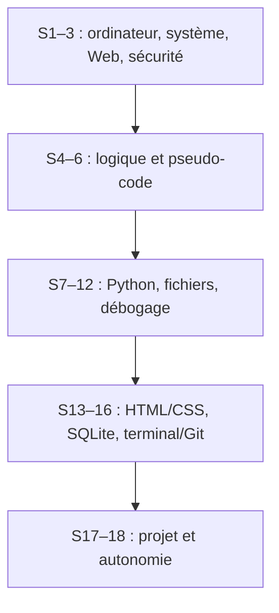

# Index — formation informatique débutante, 18 semaines

**Pour commencer :** [mode d'emploi](README_COMMENCER_ICI.md) · [guide complet](GUIDE_COMPLET.md) · [calendrier détaillé](00_ADMIN/PARCOURS_18_SEMAINES.md) · [suivi à remplir](SUIVI_18_SEMAINES.csv).

Travaille 3–5 h par semaine, à ton rythme. Le dossier est utilisable hors ligne après l'installation de Thonny ; les liens externes sont des compléments. Crée `mes_exercices` à côté de ce dossier pour tes propres essais. Lis un cours, reproduis son exemple, choisis 1–2 exercices de la semaine, puis compare avec le corrigé séparé. Une semaine avec beaucoup d'activités propose des choix : il n'est pas nécessaire de tout finir avant de continuer si les contrôles essentiels sont compris.

Le schéma résume l'ordre ; le tableau ci-dessous indique quoi ouvrir. Les mentions « projet » peuvent se répartir sur plusieurs semaines. **P4, page portfolio, est un projet complémentaire facultatif** : le projet Python final suffit pour conclure le tronc commun.

| Semaines | Cours et tâche principale | Exercices proposés | Bilan ou projet |
|---|---|---|---|
| 1 | [M00 — fichiers et logiciels](01_COURS/M00.md) | [T01](03_EXERCICES/ATELIERS_SYSTEME_RESEAU_GIT.md) | Retrouver un document fermé. |
| 2–3 | [M01 — matériel, réseaux et sécurité](01_COURS/M01.md) | T02–T03 dans les [ateliers](03_EXERCICES/ATELIERS_SYSTEME_RESEAU_GIT.md) | [Quiz J03](03_EXERCICES/QUIZ_ET_BILANS.md). |
| 4–6 | [M02 — pseudo-code](01_COURS/M02.md) | A01–A10 dans [algorithmique](03_EXERCICES/ENONCES_ALGORITHMIQUE.md) | [Quiz J06](03_EXERCICES/QUIZ_ET_BILANS.md). Scratch est facultatif. |
| 7–9 | [M03 — Python, premières parties](01_COURS/M03.md) | A11–A14 ; P01–P12 dans [Python](03_EXERCICES/ENONCES_PYTHON.md) | Refaire la traduction d'un problème sans copier. |
| 10–11 | [M03 — données et fonctions](01_COURS/M03.md) | A15 ; P13–P21 | [P1 calculatrice](06_PROJETS/P1_CALCULATRICE/ENONCE.md) ; moyenne fictive du cours et [P2 quiz](06_PROJETS/P2_QUIZ/ENONCE.md) facultatifs. |
| 12 | [M04 — débogage et fichiers](01_COURS/M04.md) | P22–P25 | [Quiz J12](03_EXERCICES/QUIZ_ET_BILANS.md) ; début de [P3 tâches](06_PROJETS/P3_TACHES_LOCALES/ENONCE.md) ; carnet de dépenses facultatif. |
| 13–14 | [M05 — HTML et CSS](01_COURS/M05.md) | W01–W08 dans [Web](03_EXERCICES/ENONCES_WEB.md) | [P4 portfolio](06_PROJETS/P4_PORTFOLIO_LOCAL/ENONCE.md), facultatif. |
| 15 | [M06 — données et SQLite](01_COURS/M06.md) | Q01–Q05 dans [SQL](03_EXERCICES/ENONCES_SQL.md), avec [la fiche pas à pas](02_FICHES/PRATIQUER_SQL_PAS_A_PAS.md) | Interroger une base fictive en mémoire. |
| 16 | [M07 — terminal et Git](01_COURS/M07.md) | T04–T05 dans les [ateliers](03_EXERCICES/ATELIERS_SYSTEME_RESEAU_GIT.md) | Deux versions d'un README local. |
| 17–18 | [M08 — projet autonome](01_COURS/M08.md) | Refaire les exercices utiles au projet choisi | [P2](06_PROJETS/P2_QUIZ/ENONCE.md) ou [P3](06_PROJETS/P3_TACHES_LOCALES/ENONCE.md), puis [Quiz J18](03_EXERCICES/QUIZ_ET_BILANS.md). |

## Aides et solutions à ouvrir après un essai

- [Installation et dépannage](02_FICHES/INSTALLATION_ET_DEPANNAGE.md), [lexique FR–EN](02_FICHES/LEXIQUE_FR_EN.md), [mémo pseudo-code/Python](02_FICHES/MEMENTO_PSEUDOCODE_PYTHON.md), [mémo système/Web](02_FICHES/MEMENTO_SYSTEME_WEB.md), [IA pour apprendre](02_FICHES/UTILISER_IA_POUR_APPRENDRE.md).
- Corrigés : [algorithmique](04_CORRIGES/CORRIGES_ALGORITHMIQUE.md), [Python](04_CORRIGES/CORRIGES_PYTHON.md), [Web](04_CORRIGES/CORRIGES_WEB.md), [SQL](04_CORRIGES/CORRIGES_SQL.md), [ateliers](04_CORRIGES/CORRIGES_ATELIERS.md), [quiz](04_CORRIGES/CORRIGES_QUIZ.md). [Exemples exécutables](05_CODE_EXEMPLES/README.md) dans les sous-dossiers Python, Web et SQL.
- Chaque projet possède un `ENONCE.md`, des `INDICES.md`, des `CRITERES.md` avec trois tests, puis une `SOLUTION/` distincte. [Dix idées pour la suite](06_PROJETS/IDEES_POUR_LA_SUITE.md).
- [16 ressources externes sélectionnées, dont 4 vidéos](07_RESSOURCES/SITES_ET_VIDEOS_VERIFIES.md) et [méthode autonome avec l'IA](07_RESSOURCES/METHODE_AUTOFORMATION_IA.md). Les ressources en ligne sont optionnelles.
- **Après S11, au choix et hors tronc commun :** [quatre activités supplémentaires](03_EXERCICES/OPTIONS_APRES_S11.md), leurs [corrigés séparés](04_CORRIGES/OPTIONS_APRES_S11.md) et la [fiche Auteur/Livre](02_FICHES/AUTEUR_LIVRE.md).

## Pour accompagner ou contrôler

[Note pour l'accompagnant](NOTE_POUR_L_ACCOMPAGNANT.md) · [inventaire et audit des sources](00_ADMIN/SELECTION_SOURCES.md) · [corrections techniques](00_ADMIN/AUDIT_ERREURS.md) · [résultats des tests](08_CONTROLES/RESULTATS_TESTS.md) · [validation finale](08_CONTROLES/VALIDATION_FINALE.md) · [manifeste](08_CONTROLES/MANIFESTE_FINAL.csv).
